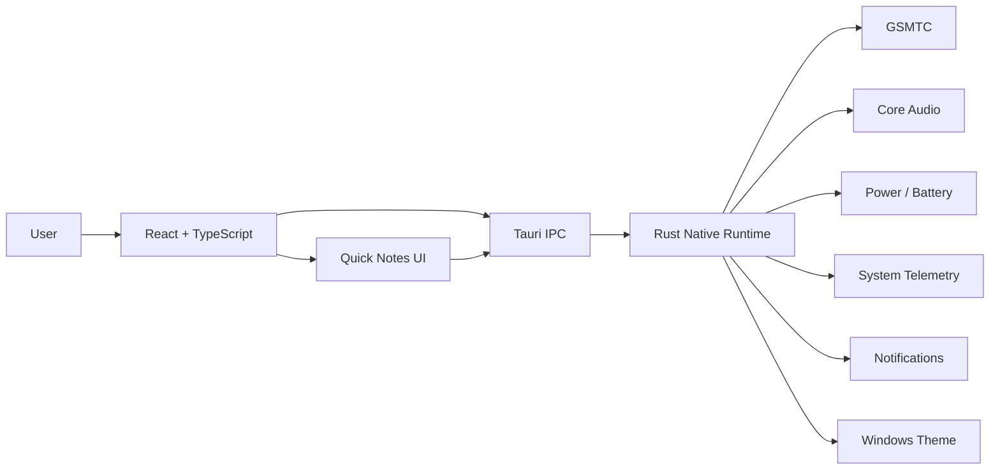

<div align="center">

# ◉ ORBIT

### Your desktop, in motion.

**A lightweight Windows desktop companion for native media controls, system monitoring, Quick Notes and contextual interactions — all inside a compact Dynamic-Island-style interface.**

<br>

[](https://github.com/AsherFerdinand/orbit-desktop/releases/tag/v0.5.0)


<br>

**[Download ORBIT 0.5.0](https://github.com/AsherFerdinand/orbit-desktop/releases/download/v0.5.0/ORBIT-0.5.0-windows-x64.exe)**
&nbsp;·&nbsp;
[Release Notes](https://github.com/AsherFerdinand/orbit-desktop/releases/tag/v0.5.0)

</div>

---

## ◉ Meet ORBIT

ORBIT is an always-on-top Windows companion designed to stay **quiet when you don't need it and interactive when you do**.

In its collapsed state, ORBIT provides glanceable information without taking over the desktop. Hover over the island and it expands into an interactive workspace for **media controls, system information and Quick Notes**.

Built with **Tauri 2, Rust, React and TypeScript**, ORBIT connects directly to native Windows functionality instead of behaving like a standalone web dashboard.

> **Local by design.** No ORBIT account, cloud backend or browser extension is required.

<br>

### Ambient Mode

<div align="center">


<br>

<sub>Compact, always-on-top and designed to stay out of the way.</sub>

</div>

<br>

### Interactive Mode

<div align="center">


<br>

<sub>Hover to expand — control media, inspect system state and work with Quick Notes.</sub>

</div>

---

## ✦ What ORBIT Can Do

| | Capability | What it does |
|:---:|---|---|
| ◉ | **Ambient Island** | Floats above the desktop and automatically expands or collapses around your interaction. |
| ♫ | **Native Media** | Reads Windows GSMTC sessions for metadata, artwork and playback controls. |
| ▶ | **Seekable Timeline** | Click or drag through media when the active Windows session supports seeking. |
| ◐ | **System Monitoring** | Displays battery, charging state, CPU, RAM and local network information. |
| ◖ | **Volume HUD** | Reacts to native Windows volume changes with a compact temporary indicator. |
| ▱ | **Quick Notes** | Create, edit, complete and manage locally stored notes directly from the island. |
| ◷ | **Reminders** | Attach a date/time to a note and receive a native Windows notification. |
| ◑ | **Appearance** | Control ORBIT's appearance and the current Windows Light/Dark preference. |

---

## ♫ Native Media Integration

ORBIT integrates with **Windows Global System Media Transport Controls (GSMTC)** rather than scraping browser content or requiring an extension.

It can expose:

- Track title and artist
- Album artwork
- Play / pause
- Previous / next
- Playback progress
- Click-to-seek
- Drag-to-seek
- Capability-aware controls
- Automatic media-session selection

ORBIT prioritises **YouTube and YouTube Music running through Brave** while still working with compatible Windows media sessions.

When Windows does not expose a capability, ORBIT does not fake it. Unsupported seekable timelines remain read-only, while unavailable timelines are omitted.

---

## ▱ Quick Notes

Quick Notes turn the island into a small temporary workspace without requiring a separate notes application.

```text
Write
  ↓
Save locally
  ↓
Add reminder (optional)
  ↓
Windows notification
```

Notes support:

**Create · Edit · Complete · Reopen · Delete · Remind**

Small paper indicators remain visible around the island so saved notes can be recognised at a glance.

### Reminder behaviour

Reminders are persisted locally and restored when ORBIT restarts.

Completing or deleting a note cancels its pending reminder. Changing a reminder to a new future time rearms it, while fired reminders are protected against duplicate delivery.

> ORBIT must be running for reminders to fire. It may remain hidden in the background.

---

## ⚙ Native Windows Integration

ORBIT is not simply a React interface wrapped in a desktop window. Native functionality is handled by the Rust/Tauri layer.

| Windows capability | ORBIT integration |
|---|---|
| 🎵 Media sessions | **Windows GSMTC** |
| 🔊 Audio | **Windows Core Audio** |
| 🔋 Battery / charging | **Native Windows power integration** |
| 🖥 System telemetry | **Native system monitoring** |
| 🔔 Reminders | **Windows notifications** |
| ◐ Appearance | **Windows current-user theme preferences** |

This keeps Windows-specific responsibilities on the native side while React remains responsible for presentation and interaction.

---

## ◇ Architecture



### Design principles

- **React owns presentation and interaction.**
- **Rust owns native Windows integration.**
- Media processing remains isolated where required by Windows COM/WinRT behaviour.
- Native callbacks are preferred where practical instead of unnecessary polling.
- Notes and settings remain local.
- ORBIT uses a single-window overlay architecture rather than multiple independent widgets.

For the deeper implementation structure, see [`CODEBASE-MAP.md`](CODEBASE-MAP.md).

---

## ◐ Designed to Stay Out of the Way

ORBIT changes how frequently it performs background work depending on what the user can actually see.

```text
EXPANDED
    │
    │  active telemetry
    ▼
COLLAPSED
    │
    │  reduced sampling
    ▼
HIDDEN
       minimal background work
```

Some examples:

- CPU/RAM monitoring runs only when the relevant metrics are useful.
- Network sampling adapts between active, collapsed and hidden states.
- Opening ORBIT triggers an immediate refresh instead of waiting for the next slow background sample.
- Battery and audio use native callbacks where appropriate.
- Media artwork is transferred only when its identity changes.
- Artwork caching is bounded.
- Unchanged notes and settings avoid unnecessary persistence writes.

These are architectural optimisations rather than claims of a specific RAM or CPU reduction.

---

## 🛠 Tech Stack

### Application


### Windows Integration


### Engineering


---

## ↓ Download

### Windows x64

**[Download ORBIT 0.5.0 →](https://github.com/AsherFerdinand/orbit-desktop/releases/download/v0.5.0/ORBIT-0.5.0-windows-x64.exe)**

Or view the complete:

**[ORBIT 0.5.0 GitHub Release](https://github.com/AsherFerdinand/orbit-desktop/releases/tag/v0.5.0)**

### Requirements

| Requirement | Status |
|---|---|
| Windows 11 | Recommended |
| Windows 10 | Supported |
| Architecture | x64 |
| Microsoft Edge WebView2 Runtime | Required |
| Browser extension | Not required |
| ORBIT account | Not required |
| Administrator rights | Not required for normal operation |

> **Note:** The current portable executable is unsigned, so Windows may display a security warning.

The portable build contains its frontend assets and does **not** require localhost or a development server.

---

## ↗ Using ORBIT

| Action | Result |
|---|---|
| **Hover / click** | Expand the island |
| **Move away** | Automatically collapse |
| **Click media progress** | Seek when supported |
| **Drag media progress** | Scrub through supported media |
| **Quick Note** | Save a local note |
| **Clock** | Add an optional reminder |
| **Right-click / tray** | Open advanced controls |
| **Esc** | Collapse when no protected interaction is active |

ORBIT protects active interactions such as note editing and media scrubbing from automatic collapse.

---

## ⌂ Local by Design

ORBIT does not require an external service to provide its core functionality.

```text
Your PC
│
├── Windows APIs
│     ├── Media
│     ├── Audio
│     ├── Battery
│     ├── Telemetry
│     └── Notifications
│
├── ORBIT
│
└── Local App Data
      ├── Notes
      └── Settings
```

Notes and preferences are stored under:

```text
%APPDATA%/com.orbit.desktop/
```

ORBIT does not require:

- an ORBIT account
- a cloud backend
- a browser extension
- an external analytics service for system telemetry

---

<details>
<summary><strong>▸ Notes, persistence & reminder details</strong></summary>

<br>

Notes use stable IDs and persisted reminder state.

Existing notes and settings are reused across upgrades, and previous-file backups are retained. Invalid or corrupt files are preserved rather than silently discarded.

Current note limits:

- 500 notes
- 500 Unicode characters per note
- 2 MiB notes file

Unsaved drafts survive running-app overlays but not process exit.

For reminders, ORBIT stores an absolute timestamp and durable fired state to reduce duplicate notification delivery.

Notification banners remain subject to Windows notification and Do Not Disturb settings.

Notification click-to-open is not currently implemented.

</details>

<details>
<summary><strong>▸ Media implementation details</strong></summary>

<br>

Windows determines GSMTC session granularity. A browser tab is therefore not guaranteed to appear as an independent media session.

ORBIT cannot invent metadata, artwork or controls that the native media session does not expose.

Browser commands may also be declined by the media source.

Live and DVR timelines may not represent a complete recording.

Artwork is sourced from the native media session and is bounded to prevent unrestricted thumbnail memory usage.

</details>

<details>
<summary><strong>▸ Telemetry behaviour</strong></summary>

<br>

ORBIT adjusts system monitoring according to application state.

Network monitoring uses an adaptive schedule:

| State | Interval |
|---|---:|
| Active / expanded | ~2 s |
| Collapsed | ~10 s |
| Hidden | ~30 s |

CPU/RAM monitoring is disabled where the information is not useful.

Battery monitoring preserves native power callbacks with a slower fallback while hidden.

These readings remain local system information and are not external analytics.

</details>

---

## </> Development

### Clone

```powershell
git clone https://github.com/AsherFerdinand/orbit-desktop.git
cd orbit-desktop
npm ci
```

### Run

```powershell
npm run tauri -- dev
```

### Optimized build

```powershell
npm run tauri -- build --no-bundle
```

The resulting executable is written to:

```text
src-tauri/target/release/orbit-desktop.exe
```

### Requirements

Development requires:

- Node.js 22+
- Rust stable MSVC
- Visual Studio C++ Build Tools
- Windows SDK
- Microsoft Edge WebView2

---

## ✓ Validation

ORBIT includes automated frontend and native Rust testing alongside manual Windows integration verification.

```powershell
npm run typecheck
npm test
cargo test --manifest-path src-tauri/Cargo.toml
```

The release validation report documents the actual verification performed for 0.5.0.

**[View ORBIT 0.5.0 validation →](docs/RELEASE-0.5.0.md)**

---

## △ Current Limitations

- ORBIT must remain running for Quick Note reminders to fire.
- Notification click-to-open is not yet implemented.
- Media functionality depends on capabilities exposed by the active Windows GSMTC session.
- Browser media-session granularity is controlled by Windows/browser behaviour.
- The current portable Windows executable is unsigned.

---

## ≡ Documentation

| Document | Description |
|---|---|
| **[Release Validation](docs/RELEASE-0.5.0.md)** | Verification evidence for ORBIT 0.5.0 |
| **[Changelog](docs/CHANGELOG.md)** | Version history and release changes |
| **[Codebase Map](CODEBASE-MAP.md)** | Architecture and component ownership |
| **[Contributor Guidance](AGENTS.md)** | Repository development guidance |

---

<div align="center">

### ◉ ORBIT

**Native Windows integration · Lightweight desktop UX · Rust × React**

Built as an exploration of native Windows integration, contextual desktop interfaces and Rust/React interoperability.

<br>


</div>
